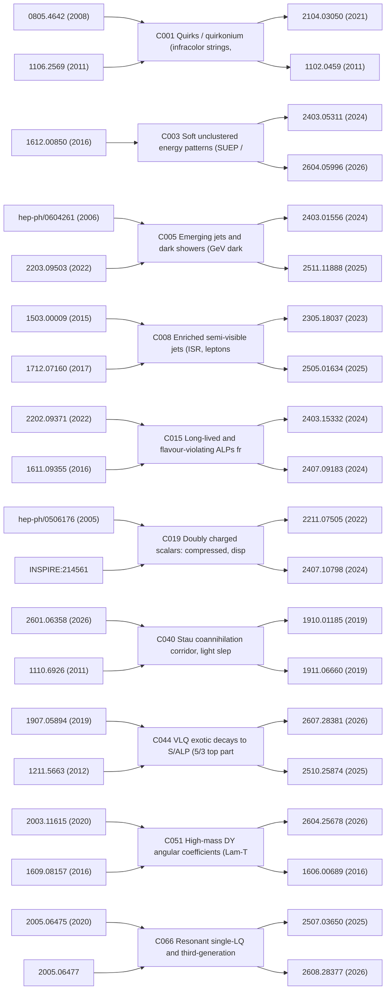

# Research-lineage graph

Edges are curated lineage (seminal → development → pheno prediction → experimental result), assembled from the scouts' `seminal_refs`, `followup_refs` and `exp_coverage_seen`, then corrected by the Gate 2/3/4 reviews. It is **not** an exhaustive citation network; full-network traversal was done per seed with INSPIRE `refersto`/`citedby:recid` queries (logged in each `scout_*.json`).

The status at the end of each chain is the gate result: Gate 2 verdict (P/H/R) and Gate 3 adversarial verdict where available.

## C001 Quirks / quirkonium (infracolor strings, stopped, soft-pion showers)
- Status: Gate2 **PASS**; Gate3 **NARROWED**; found by 5 scout(s)
- Foundational: 0805.4642 (2008), 1106.2569 (2011), 1708.02243 (2017), 1512.05782 (2015), 1501.05310 (2015), 1812.08173 (2018)
- Development/pheno: 1708.02243 (2017), 1811.08903 (2018), 2104.03050 (2021), 2504.02940 (2025), 2506.11192 (2025), 2607.26195 (2026), 2509.08878 (2025), 2404.13814 (2024)
- Experimental coverage seen: 2104.03050 (2021), 1102.0459 (2011), 2607.26195 (2026), 2403.05311 (2024), 2605.20015 (2026), 2607.09621 (2026)
- Gate-2 gap statement: INSPIRE (collaboration:CMS/ATLAS + 'quirk' in abstract) returns no CMS or ATLAS quirk search; only FASER (forward, QCD-colourless, charge +-1) and phenomenology (2504.02940, 2506.11192, 1708.02243) exist. Open: central-detector search for EW-charged quirks (non-helical tracks / soft-track anomalies 

## C002 Neutral-naturalness glueball / hidden-valley LLPs (twin Higgs, folded SUSY)
- Status: Gate2 **HOLD**; Gate3 **—**; found by 3 scout(s)
- Foundational: hep-ph/0506256 (2005), hep-ph/0609152 (2006), hep-ph/0604261 (2006), 1506.06141 (2015), 1501.05310 (2015), 0805.4667 (2008)
- Development/pheno: 1512.05782 (2015), 2504.02940 (2025), 2203.05531 (2022), 1812.08173 (2018), 2310.13731 (2023), 1806.07396 (2018)
- Experimental coverage seen: 2603.01991 (2026), 2311.18298 (2023), INSPIRE:3186732, 2107.06092, 2409.10806 (2024), INSPIRE:1864917
- Gate-2 gap statement: Higgs->glueball DV is covered by many Run-2/3 Higgs->LLP searches; a residual gap (top-partner pair -> glueballs, sub-cm decay lengths, theory refs 1512.05782, 2310.13731) is plausible but no search/reinterpretation evidence checked in detail.

## C003 Soft unclustered energy patterns (SUEP / soft bombs)
- Status: Gate2 **PASS**; Gate3 **NARROWED**; found by 1 scout(s)
- Foundational: 1612.00850 (2016)
- Development/pheno: 2107.12379 (2021), 2306.13595 (2023), 2506.11192 (2025)
- Experimental coverage seen: 2403.05311 (2024), 2604.05996 (2026), 2605.20015 (2026), recid:3132607
- Gate-2 gap statement: All CMS/ATLAS SUEP searches (2403.05311, 2607.09621, 2604.05996, 2605.20015) assume prompt dark-photon decay; no search with displaced dark-meson decays (cτ >~ mm) or VBF/non-ggF production found (abstracts.value:SUEP and displaced returned nothing).

## C004 Anomaly detection for dark showers / hidden valley (trigger-level)
- Status: Gate2 **HOLD**; Gate3 **—**; found by 2 scout(s)
- Foundational: 2203.09503 (2022), 2006.08639 (2020), 2101.08320 (2021)
- Development/pheno: 2510.02168 (2025), 2312.03067 (2023), 2306.13595 (2023), 2107.12379 (2021)
- Experimental coverage seen: 2510.02168 (2025), (no arXiv; recid 2751629), 2502.09770 (2025), 2512.20395 (2025), 2508.19778 (2025)
- Gate-2 gap statement: Not a signature gap: a method. Open item is only robustness of AE tagging to dark-hadronisation parameters; no measurable distinct observable.

## C005 Emerging jets and dark showers (GeV dark pions, Higgs portal, triggers)
- Status: Gate2 **PASS**; Gate3 **NARROWED**; found by 4 scout(s)
- Foundational: hep-ph/0604261 (2006), 2203.09503 (2022), 2103.01238 (2021), 2110.10691 (2021), 1502.05409 (2015), 1312.4992 (2013)
- Development/pheno: 2511.11888 (2025), 2505.03058 (2025), 2606.30760 (2026), 2507.13430 (2025), 2307.04847 (2023), 2511.02918 (2025), 2403.16134 (2024), 2512.24814 (2025)
- Experimental coverage seen: 2403.01556 (2024), 2511.11888 (2025), 2503.20445 (2025), 2505.02429 (2025), (no arXiv; recid 2963506), (no arXiv; recid 3201494)
- Gate-2 gap statement: Run-2/3 EJ searches target QCD-produced t/s-channel mediators with m_pi 10-20 GeV; the muon-rich Higgs-decay search covers m_pi 1-12 GeV. Hadronic displaced dark showers from Higgs-portal (VBF/VH-tagged) and from EW pair production are not covered by a published full search found.

## C006 Z decays to dark showers / hidden radiation
- Status: Gate2 **HOLD**; Gate3 **—**; found by 1 scout(s)
- Foundational: 2110.10691 (2021), 1906.02198 (2019), 1412.0018 (2014), 1705.01105 (2017)
- Development/pheno: 2401.08785 (2024), 2605.03427 (2026)
- Experimental coverage seen: 2110.13218 (2021), 2311.00130 (2023), 2511.11888 (2025), (no arXiv; recid 2909612), 2112.13769 (2021), 2309.16003 (2023)
- Gate-2 gap statement: No ATLAS/CMS/LHCb search found for Z -> dark-shower bbmumu (only Higgs-sourced analogues). Viability depends on soft-muon/b trigger acceptance, not verified.

## C007 Dark-shower substructure: Lund plane / EEC observables
- Status: Gate2 **HOLD**; Gate3 **—**; found by 1 scout(s)
- Foundational: 2301.07732 (2023), 1807.04758 (2018)
- Development/pheno: 2606.25513 (2026), 2606.30760 (2026)
- Experimental coverage seen: 2403.01556 (2024), 2505.01634 (2025), 2608.05323 (2026), 2004.03540 (2020)
- Gate-2 gap statement: No CMS/ATLAS dark-shower analysis using LJP/EEC found (INSPIRE queries empty); only theory 2301.07732 and 2609.11692 (ML tagging).

## C008 Enriched semi-visible jets (ISR, leptons, photons, taus)
- Status: Gate2 **PASS**; Gate3 **NARROWED**; found by 1 scout(s)
- Foundational: 1503.00009 (2015), 1712.07160 (2017)
- Development/pheno: 2206.03909 (2022), 2409.04741 (2024), 2407.08276 (2024), 2608.05323 (2026)
- Experimental coverage seen: 2305.18037 (2023), 2505.01634 (2025), (no arXiv; recid 2963506), (no arXiv; recid 3136606), (no arXiv; recid 3185627)
- Gate-2 gap statement: Lepton/tau-enriched s-channel SVJ now searched by CMS; ISR-recoil SVJ (photon or jet, 2409.04741: 'ISR channel not yet explored') and low-mass Z' (0.5-1 TeV) have no CMS/ATLAS search found.

## C009 Semi-visible/semi-dark Higgs decays (h->Z+inv, ll+MET)
- Status: Gate2 **PASS**; Gate3 **NARROWED**; found by 2 scout(s)
- Foundational: 2511.09778 (2025), 1312.4992 (2013), 1708.00443 (2017)
- Development/pheno: 2607.09344 (2026), 2206.01214 (2022)
- Experimental coverage seen: 2211.05426, 2212.09649 (2022), 2301.10731 (2023)
- Gate-2 gap statement: No ATLAS/CMS search for h -> Z + invisible X found (INSPIRE: only photon+MET and bb+MET exotic Higgs decays); theory-only HL-LHC projections exist.

## C010 Compressed / inelastic-DM soft displaced leptons and tracks
- Status: Gate2 **REJECT**; Gate3 **—**; found by 4 scout(s)
- Foundational: hep-ph/0101138 (2001), 1508.03050 (2015), 1810.01879 (2018), 2007.03708 (2020), 1910.08065 (2019), 1810.12602 (2018)
- Development/pheno: 2305.11649 (2023), 2602.18051 (2026), 2511.20042 (2025), 2511.08212 (2025), 2410.16835 (2024), 2107.11405 (2021), 2209.13128 (2022), 2311.17149 (2023)
- Experimental coverage seen: 2305.11649 (2023), (no arXiv; recid 3186741), (no arXiv; recid 2784289), 2511.16394 (2025), 2511.20042 (2025), 2511.08212 (2025)
- Gate-2 gap statement: Residual only: ATLAS iDM analogue and iDM with Delta/m1 < 10%; not a distinct signature.

## C011 Displaced dark Higgs and dark Higgs-strahlung
- Status: Gate2 **HOLD**; Gate3 **—**; found by 2 scout(s)
- Foundational: 1701.08780 (2017), 1002.2952 (2010)
- Development/pheno: 2010.06548 (2020), 2507.02175 (2025), 2604.20999 (2026), 2507.07089 (2025)
- Experimental coverage seen: 2010.06548 (2020), 2604.20999 (2026), 2003.11956 (2020), 1409.0746 (2014)
- Gate-2 gap statement: Displaced mono-dark-Higgs (MET + displaced bb/WW decay) has no dedicated interpretation; generic DV+MET (2603.12051) could be recast. Prompt Z->A'h_D already searched (2306.07413).

## C012 Freeze-in long-lived mediators / displaced photons
- Status: Gate2 **HOLD**; Gate3 **—**; found by 2 scout(s)
- Foundational: 1908.11387 (2019), 2507.15930 (2025)
- Development/pheno: 2412.18721 (2024), 2411.09464 (2024), 2507.07089 (2025)
- Experimental coverage seen: 2003.11956 (2020), 2201.02472 (2022), 2402.01898 (2024), 1409.5542, 1909.06166 (2019)
- Gate-2 gap statement: Mostly a cosmological framing of existing LLP signatures; only potential gap is HL-LHC timing-based delayed-photon reach; not established.

## C013 Millicharged and high-charge particles in main detectors
- Status: Gate2 **PASS**; Gate3 **NARROWED**; found by 2 scout(s)
- Foundational: hep-ph/0001179 (2000), 1410.6816 (2014), 1506.04760 (2015), hep-ph/9802310 (1998)
- Development/pheno: 2402.09932 (2024), 2506.02251 (2025), 2010.07941 (2020), 1808.08942 (2018)
- Experimental coverage seen: 2402.09932 (2024), 2506.02251 (2025), 2104.07151 (2021), 2303.13613 (2023), 1903.08491 (2019)
- Gate-2 gap statement: No ATLAS/CMS result found for 8<=|z|<=19 (ATLAS stops at 7 and restarts at 20; CMS 13 TeV multi-charged coverage UNVERIFIED) and for FCP charges below e/3 in main detectors (CMS stops at e/3; ATLAS has no result).

## C014 FCNC top/charm decays to dark photon (dark penguins)
- Status: Gate2 **HOLD**; Gate3 **—**; found by 1 scout(s)
- Foundational: 1607.05928 (2016), 1503.04204 (2015)
- Development/pheno: 2606.07749 (2026)
- Experimental coverage seen: (query result empty)
- Gate-2 gap statement: No CMS/ATLAS search or interpretation for t->u/c + invisible (massless dark photon) found via INSPIRE (2 collab queries empty, refersto 1477224 returns no CMS/ATLAS paper); sensitivity to BR not quantified.

## C015 Long-lived and flavour-violating ALPs from top/Higgs decays
- Status: Gate2 **PASS**; Gate3 **NARROWED**; found by 2 scout(s)
- Foundational: 2202.09371 (2022), 1611.09355 (2016), 2110.10698 (2021), 1704.08207 (2017)
- Development/pheno: 2306.08686 (2023), 2404.06126 (2024), 2510.24097 (2025)
- Experimental coverage seen: 2403.15332 (2024), 2407.09183 (2024), 2402.11098 (2024), INSPIRE:3171358, INSPIRE:2903120
- Gate-2 gap statement: ATLAS 2403.15332 sets t->aq limits only for m_a 40-55 GeV, ctau 1.6-130 mm (hadronic ID DV); region m_a ~2-10 GeV, cTau 0.006-10 m (2202.09371 gap quote), and leptonic/photonic ALP decays and calorimeter/muon-system decays in ttbar have no CMS/ATLAS result found.

## C016 Dark photon / low-mass dimuon / lepton-jets with scouting & HL triggers
- Status: Gate2 **HOLD**; Gate3 **—**; found by 5 scout(s)
- Foundational: 1403.1269 (2014), 1107.5238 (2011), 1511.05542 (2015), 1412.0018 (2014), 1603.01377 (2016), 1603.08926 (2016)
- Development/pheno: 2412.19261 (2024), 2205.10976 (2022), 2206.05297 (2022), 2609.24527 (2026), 2309.16003 (2023), 2403.16134 (2024), 2212.09649 (2022), 1806.07396 (2018)
- Experimental coverage seen: 1808.03684 (2018), 1912.04776 (2019), 1511.05542 (2015), 2606.25840 (2026), 2407.20425 (2024), 2406.01656 (2024)
- Gate-2 gap statement: Only residual: one displaced lepton-jet recoiling against ISR/MET (gap quote is from a 2018 MATHUSLA document, arXiv:1806.07396, i.e. stale) and displaced electron lepton-jets; not verified either way.

## C017 Pseudo-Dirac HNL: LNV vs LNC split, oscillations
- Status: Gate2 **PASS**; Gate3 **NARROWED**; found by 2 scout(s)
- Foundational: 2203.08039 (2022), INSPIRE recid:189726, hep-ph/0104123 (2001)
- Development/pheno: 2606.25982 (2026), 2212.00562 (2022), 1607.05641 (2016), 1308.3226 (2013)
- Experimental coverage seen: 2503.16213 (2025), 2204.11988 (2022), 2508.20929 (2025), 1806.10905 (2018), 1905.09787 (2019)
- Gate-2 gap statement: CMS/ATLAS HNL results give Dirac or Majorana limit only; none reports LNV/LNC fraction as a function of HNL mass splitting or oscillation (decay-length) for the pseudo-Dirac regime, where 2606.25982 shows LNV is suppressed.

## C018 HNL: boosted, tau-flavoured, VBF, displaced-shower and portal variants
- Status: Gate2 **HOLD**; Gate3 **—**; found by 4 scout(s)
- Foundational: INSPIRE:99112, 0907.4193 (2009), 1504.02470 (2015), 2407.20676 (2024), 1912.08206 (2019), 1107.3463 (2011)
- Development/pheno: 2207.06857 (2022), 2411.14910 (2024), 1802.00945 (2018), 2207.02742 (2022), 2212.00562 (2022), 2503.22112 (2025), 2304.06109 (2023), 2608.27868 (2026)
- Experimental coverage seen: INSPIRE:3186740, 2112.03949 (2021), 2304.09553 (2023), 2008.07949 (2020), 1708.07962 (2017), 2407.10717 (2024)
- Gate-2 gap statement: Best residual: HNL (RHN from W/Higgs) interpreted in CMS muon-system displaced-shower analyses with a prompt-lepton requirement; other sub-themes (type-III, WR->tau N, boosted N) have dedicated Run 2 searches.

## C019 Doubly charged scalars: compressed, displaced, tau/W cascades
- Status: Gate2 **PASS**; Gate3 **NARROWED**; found by 4 scout(s)
- Foundational: hep-ph/0506176 (2005), INSPIRE:214561, 1710.09748 (2017), 0909.4419 (2009), 1105.2209 (2011)
- Development/pheno: 1808.00943 (2018), 1909.07429 (2019), 2608.03988 (2026), 2603.09244 (2026), 2608.27251 (2026), 2410.19561 (2024), 1710.09748 (2017)
- Experimental coverage seen: 2211.07505 (2022), 2407.10798 (2024), INSPIRE:2084511, 1808.01899 (2018), 2101.11961 (2021), 2410.09164 (2024)
- Gate-2 gap statement: No CMS/ATLAS search found for H++ with proper decay length 0.1-100 mm (neither prompt multilepton nor stable HSCP cover it, per 2608.27251 survey of existing searches); compressed low-m_ll same-sign pair also untested (2305.06889).

## C020 Electroweak-charged dark mesons (5-plet)
- Status: Gate2 **REJECT**; Gate3 **—**; found by 1 scout(s)
- Foundational: 2507.13430 (2025), 2412.14240 (2024)
- Development/pheno: —
- Experimental coverage seen: 2201.02472 (2022), 2603.08315 (2026)
- Gate-2 gap statement: None distinct: signatures reduce to standard diphoton/diboson resonance and disappearing-track searches already recast; only the G-violating vector-meson decay is open, with no distinct collider observable specified.

## C021 Fully merged ALP photons, ALP VBF with parking/L1 scouting
- Status: Gate2 **PASS**; Gate3 **NARROWED**; found by 1 scout(s)
- Foundational: 1607.06083 (2016), 1509.00476 (2015), 1708.00443 (2017), 1808.10323 (2018), 2403.16134 (2024), 2101.11119 (2021)
- Development/pheno: 2607.12004 (2026), 2609.22570 (2026)
- Experimental coverage seen: 1808.10515 (2018), 2601.00183 (2026), 2603.03250 (2026), 2111.13669 (2021)
- Gate-2 gap statement: Only an indirect bound exists (2607.12004 recast of ATLAS high-mass diphoton search, no dedicated experiment analysis); no CMS/ATLAS search for single merged-photon ALP with substructure for 0.1-6 GeV or for VBF+merged photon in scouting/parking.

## C022 Photon-fusion ALPs: proton tags <150 GeV, UPC light-by-light, monopoles
- Status: Gate2 **HOLD**; Gate3 **—**; found by 1 scout(s)
- Foundational: 1803.10835 (2018), 1305.7142 (2013), 1607.06083 (2016), 1812.07688 (2018), 1808.08942 (2018), 1903.12635 (2019)
- Development/pheno: 2208.10526 (2022), 2304.10953 (2023), 2311.02725 (2023), 1810.04602 (2018), 2008.05355 (2020), 2412.15413 (2024), 2408.11035 (2024), 2402.15682 (2024)
- Experimental coverage seen: 2304.10953 (2023), 2311.02725 (2023), 2603.20837 (2026), 2412.15413 (2024), 2008.05355 (2020), 2408.11035 (2024)
- Gate-2 gap statement: Proton-tagged diphoton below 150 GeV (single-tag acceptance 0.02<xi<0.12 per 2208.10526) and UPC LbL ALP below 5 GeV have no CMS/ATLAS result found; ATLAS pilot LbL trigger optimisation (recid 2751571) suggests the UPC low-mass effort is under way.

## C023 h->aa mixed final states (2mu4gamma, ll gamma gamma, gg gamma gamma, 4tau in HH), h->Za
- Status: Gate2 **PASS**; Gate3 **NARROWED**; found by 2 scout(s)
- Foundational: 1312.4992 (2013), 1704.08207 (2017), 1701.05379 (2017), 1708.00443 (2017)
- Development/pheno: 2203.14984 (2022), 2608.18506 (2026), 2607.21712 (2026), 2312.01942 (2023), 2111.12751 (2021), 2211.07674 (2022)
- Experimental coverage seen: 2312.03306 (2023), 2601.00183 (2026), 2403.10341 (2024), 2211.04172 (2022), 2603.03250 (2026), 2312.01942 (2023)
- Gate-2 gap statement: Searches cover h->Za(ll on Z, gamma gamma), 4gamma, 4tau, 2mu2tau, 4b; none found for h->aa->(mu mu)(gamma gamma)/ll gamma gamma with ll off-Z, or (gg)(gamma gamma) wide-jet+photon pair (2608.18506 'no dedicated search yet'; WebSearch also found none).

## C024 Top/gluon-philic ALP and heavy (pseudo)scalar tt lineshape/interference
- Status: Gate2 **REJECT**; Gate3 **—**; found by 3 scout(s)
- Foundational: 2303.17634 (2023), hep-ph/0701186 (2007), hep-ph/0612015 (2006), 0709.0007, 1106.0034 (2011)
- Development/pheno: 2404.19014 (2024), 2508.21660 (2025), 2609.13099 (2026), 2507.05119 (2025)
- Experimental coverage seen: 2608.10148 (2026), 2304.01678 (2023), 2507.05119 (2025)
- Gate-2 gap statement: None: peak-dip lineshape for spin-0 resonances already built into CMS 2507.05119; radion is a special case of a gluon-fusion scalar.

## C025 ALP in VBS, Z->mumugamma, leptophilic/LFV ALPs
- Status: Gate2 **HOLD**; Gate3 **—**; found by 1 scout(s)
- Foundational: 1905.12953 (2019), 1708.00443 (2017), 1704.08207 (2017), 1908.00008 (2019)
- Development/pheno: 2202.03450 (2022), 2101.11119 (2021), 2604.13156 (2026), 1908.00008 (2019), 2105.05866 (2021), 2503.03179 (2025)
- Experimental coverage seen: 2111.13669 (2021), 2503.21977 (2025), 1808.03684 (2018), 1912.04776 (2019), 2508.06947 (2025), 2503.05463 (2025)
- Gate-2 gap statement: No CMS/ATLAS ALP-specific VBS interpretation or Z->mumugamma dimuon-bump search found, but evidence is thin and the VBS part is an EFT reinterpretation of existing measurements.

## C026 4D (space+time) displaced vertices and timing for slow/long-lived particles (MTD/HGTD)
- Status: Gate2 **PASS**; Gate3 **DIES**; found by 2 scout(s)
- Foundational: 1805.05957 (2018), 1812.07831 (2018), 1903.05825 (2019), 1807.05453 (2018)
- Development/pheno: 2510.24097 (2025), 2608.27868 (2026), INSPIRE:3188833, 2608.29275 (2026), 2609.28334 (2026), 2502.06694 (2025), 2410.09164 (2024), 2601.20063 (2026)
- Experimental coverage seen: 2209.01029 (2022), 2312.03306 (2023), 2212.06695 (2022), 1909.06166 (2019), 2409.10806 (2024), 2503.20445 (2025)
- Gate-2 gap statement: Pheno literature exists, but no CMS/ATLAS full-simulation Phase-2 study of delayed displaced vertex/tracks with MTD/HGTD reference-time (VBF tag) was found; experiment-level physics performance only generic.

## C027 HL-LHC displaced triggers, L1 tracking, scouting, parked data, vertexing algorithms
- Status: Gate2 **HOLD**; Gate3 **—**; found by 1 scout(s)
- Foundational: 2003.03943 (2020), 2110.14675 (2021), 2211.02171 (2022)
- Development/pheno: 2012.07864 (2020), 2008.06918 (2020), 2112.04518 (2021), 2211.02171 (2022), 2308.13611 (2023), 2307.05152 (2023), 2609.26695 (2026), 2511.08212 (2025)
- Experimental coverage seen: 2601.17544 (2026), 2508.06363, INSPIRE:2946303, 2511.08212 (2025)
- Gate-2 gap statement: No CMS/ATLAS-published physics-reach projection (limits/sensitivity vs Run-3 scouting/parking) for L1-triggered low-mass displaced dimuon or hadronic DV at HL-LHC; recid:2908980 is a trigger feasibility study only. Candidate is an enabler umbrella, not a single signature; best sub-target is B->KPhi 

## C028 ~1 cm lifetime blind spot (H->phi phi->4j, L1 track trigger)
- Status: Gate2 **REJECT**; Gate3 **—**; found by 1 scout(s)
- Foundational: hep-ph/0604261 (2006), 0712.2041 (2007)
- Development/pheno: 1810.12602 (2018)
- Experimental coverage seen: 2505.02429 (2025), 2403.01556 (2024)
- Gate-2 gap statement: The 2019 'blind spot at ~1 cm' (1902.10229, 1902.00134) is now addressed by CMS 2409.10806 for mS>40 GeV in ggF; residual region (mS<40 GeV, B<1%) is an incremental HL extension folded into C027.

## C029 Disappearing-track cascades and pure-higgsino 0.3 GeV splitting
- Status: Gate2 **PASS**; Gate3 **NARROWED**; found by 2 scout(s)
- Foundational: 2007.03708 (2020), 1911.09037 (2020), 1703.09675 (2017)
- Development/pheno: 2609.28334 (2026), 2608.29275 (2026), INSPIRE:3188833, 2201.02472 (2022), 2309.16823 (2023)
- Experimental coverage seen: 2603.08315 (2026), 2201.02472 (2022), 2410.16835 (2024), 2604.16789, 2309.16823 (2023), recid:1704585
- Gate-2 gap statement: No CMS/ATLAS search requires the correlated DT stub + delayed displaced dilepton vertex (nor uses MTD/HGTD delay for it); individual DT and DV searches are model-agnostic about the other leg. Benchmark is scotogenic (model-specific), higgsino part already has HL projections.

## C030 Emerging photon jets in HCAL
- Status: Gate2 **HOLD**; Gate3 **—**; found by 1 scout(s)
- Foundational: 2504.19693 (2025)
- Development/pheno: —
- Experimental coverage seen: 2209.01029 (2022), INSPIRE:3186732, 1409.5542, 1909.06166 (2019)
- Gate-2 gap statement: No ATLAS/CMS interpretation of photon-decaying LLPs depositing energy in the HCAL; existing ECAL photon searches stop at the ECAL and CalRatio may already be partly sensitive (unchecked), so a recast/reinterpretation is the first step.

## C031 Tumbler (sequential DV) and LLP lifetime/mass measurement
- Status: Gate2 **PASS**; Gate3 **NARROWED**; found by 1 scout(s)
- Foundational: 2108.02204 (2021), 1912.06669 (2019), 1903.05825 (2019)
- Development/pheno: 2609.28334 (2026), 2608.27868 (2026)
- Experimental coverage seen: 2301.13866 (2023), 2603.01991 (2026), 2201.05578 (2022), 2503.20445 (2025)
- Gate-2 gap statement: No ATLAS/CMS search or projection targeting vertex chains; INSPIRE forward citations of 2108.02204 show no collaboration follow-up (only pheno/DM papers). Second seed (generic lifetime/mass measurement) is vague and only supports this.

## C032 Displaced taus from light pseudoscalars
- Status: Gate2 **HOLD**; Gate3 **—**; found by 1 scout(s)
- Foundational: 2408.07366 (2024)
- Development/pheno: —
- Experimental coverage seen: INSPIRE:2866938
- Gate-2 gap statement: GeV-scale (<15 GeV, collimated) displaced tau pair and h->Za-associated topology not covered by CMS 2409.10806 (mS>=15, ggF, tau ID); pheno paper 2408.07366 shows reach already at 300/fb, so HL-specific value is unclear.

## C033 Main-detector vs far-detector complementarity (GeV LLPs)
- Status: Gate2 **REJECT**; Gate3 **—**; found by 1 scout(s)
- Foundational: 1806.07396 (2018), 1708.09395 (2017), 1811.12522 (2018)
- Development/pheno: 2609.00152 (2026), 2504.01999 (2025)
- Experimental coverage seen: 2409.10806 (2024), 2403.15332 (2024)
- Gate-2 gap statement: n/a - not a measurable signature; the 'trigger limitations' gap is C027.

## C034 R-hadrons, gluinonium, mini-split displaced/stopped signatures
- Status: Gate2 **REJECT**; Gate3 **—**; found by 2 scout(s)
- Foundational: hep-ph/0408335 (2004), hep-ph/0406088 (2004), hep-ph/0408248 (2004), 1210.0555 (2012)
- Development/pheno: 1806.07396 (2018), 1503.03099 (2015)
- Experimental coverage seen: 1211.1597 (2012), 1101.1645 (2011), 1801.00359 (2017), 2104.03050 (2021), 1710.04901 (2017), 2402.15804 (2024)
- Gate-2 gap statement: Residual: gluinonium resonances at HL (theory-only, rates UNVERIFIED) - weak motivation.

## C035 RPV with intermediate-lifetime displaced LSP
- Status: Gate2 **REJECT**; Gate3 **—**; found by 2 scout(s)
- Foundational: 1204.6038 (2012), 2306.07317 (2023)
- Development/pheno: 2603.15007 (2026), 2503.03830 (2025), 2603.01991 (2026), 2308.05804 (2023)
- Experimental coverage seen: 2603.12051 (2026), 2402.15804 (2024), 1610.05133 (2016), recid:2776180, 2301.13866 (2023), 2604.16789
- Gate-2 gap statement: Residual: electroweak-production slepton/sneutrino/higgsino LLP corners (see C038, C037); broad claim of an uncovered intermediate regime is superseded by ATLAS 2603.15007.

## C036 Baryon-number violation at colliders (DeltaB=2, quark-portal displaced MET)
- Status: Gate2 **HOLD**; Gate3 **—**; found by 2 scout(s)
- Foundational: 1708.06350 (2017), INSPIRE recid:261377, hep-ph/0508123 (2005), 1210.5622 (2012)
- Development/pheno: 2602.15936 (2026), 1602.04821 (2016), 1310.6016 (2013)
- Experimental coverage seen: 2107.13021, 2609.21850 (2026)
- Gate-2 gap statement: Displaced N->qqq + MET from quark-portal BNV not interpreted by collaborations; DV+MET searches likely sensitive, so recast needed. Second seed (DeltaB=2 same-sign tops/multijet) has no concrete uncovered signature.

## C037 UDD/BNV electroweakinos, coloured-LSP RPV, paired-dijet squarks
- Status: Gate2 **HOLD**; Gate3 **—**; found by 1 scout(s)
- Foundational: 2003.10920 (2020), 2503.03830 (2025), 1804.00067 (2018), 1204.6038 (2012)
- Development/pheno: 2602.06957 (2026), 2412.11862 (2024), 2411.07278 (2024), 2410.05421 (2024), 2309.06456 (2023), 2509.09062 (2025)
- Experimental coverage seen: recid:2773141, 2106.09609 (2021), 2503.06726, 2406.18367 (2024), recid:2053983, 2609.21850 (2026)
- Gate-2 gap statement: Top-philic UDD electroweakino signal region not explicitly targeted, but CMS jet-scaling and b-category searches may partly cover it; paired-dijet seed is now covered by 2609.21850; coloured-LSP seed is pheno-only.

## C038 Slepton/sneutrino-LSP in LQD-RPV
- Status: Gate2 **HOLD**; Gate3 **—**; found by 1 scout(s)
- Foundational: 1707.02471 (2017), 1804.00067 (2018), 2306.07317 (2023)
- Development/pheno: 2608.21033 (2026), 2310.07532 (2023), 2601.05664 (2026)
- Experimental coverage seen: 2106.09609 (2021), 2601.05664 (2026), 1811.09760
- Gate-2 gap statement: Direct slepton/sneutrino LSP LQD signals unconstrained per ABC-III recast (no ATLAS/CMS search targets low-mass l+jj pairs); HL viability unproven.

## C039 Stealth SUSY (low MET) and HL reach
- Status: Gate2 **HOLD**; Gate3 **—**; found by 2 scout(s)
- Foundational: 1105.5135 (2011), 1201.4875 (2012), 1512.05781 (2015)
- Development/pheno: 1512.05781 (2015), 2506.08825 (2025), 2310.03154 (2023), 2509.16501 (2025)
- Experimental coverage seen: 1411.7255 (2014), 2310.03154 (2023), 2506.08825 (2025), 2206.06012 (2022)
- Gate-2 gap statement: Left-handed stop/sbottom stealth topologies and 13 TeV e-mu stealth have no dedicated search; no ATLAS stealth search found by title/abstract queries; HL benefit is incremental luminosity.

## C040 Stau coannihilation corridor, light sleptons, g-2 motivated, Z'-mediated sleptons
- Status: Gate2 **PASS**; Gate3 **NARROWED**; found by 1 scout(s)
- Foundational: 2601.06358 (2026), 1110.6926 (2011), 2002.04429 (2020), 2104.03839 (2021), 2104.03302, 2608.18321 (2026)
- Development/pheno: 2403.18991 (2024), 2308.05723, 2503.17186 (2025), 2402.01888 (2024)
- Experimental coverage seen: 1910.01185 (2019), 1911.06660 (2019), 2609.37215 (2026), recid:1704284, 2402.01888 (2024), 2503.17186 (2025)
- Gate-2 gap statement: No experimental analysis excludes direct stau pair production in the coannihilation corridor beyond m(stau)~115 GeV at Delta m=30 GeV; the combined ATLAS Run2+Run3 fit gives no exclusion, and no CMS/ATLAS HL-LHC projection for the compressed ISR-tau topology was found.

## C041 Higgsino + gravitino/pseudo-goldstino (HH/ZH+MET), GMSB long-lived stau/NLSP photons
- Status: Gate2 **HOLD**; Gate3 **—**; found by 1 scout(s)
- Foundational: 2202.03258 (2022), 2311.10999 (2023), 1601.01326 (2016), 2304.01082 (2023)
- Development/pheno: 2203.14569, 2303.09082 (2023), 1902.05538 (2019), 2601.17576 (2026), 2603.08315 (2026), 2306.00982 (2023)
- Experimental coverage seen: 2201.04206 (2022), 2401.14922 (2024), 2404.01996 (2024), 2511.21240 (2025), recid:1704585, 2601.17576 (2026)
- Gate-2 gap statement: Candidate is three heterogeneous sub-directions; strongest sub-gap is delayed/non-pointing photon+MET at 13 TeV with only 77 fb-1 CMS and no found ATLAS 13 TeV result, with HL timing-detector projection missing. Coverage check for that gap incomplete (INSPIRE title queries returned little).

## C042 Dirac gauginos / sgluon / colour-octet scalars
- Status: Gate2 **HOLD**; Gate3 **—**; found by 2 scout(s)
- Foundational: 0706.0909 (2007), 0810.3919 (2008), 0812.0307 (2008), hep-ph/0206096 (2002), 1308.3468 (2013)
- Development/pheno: 1212.3360 (2012), 1501.07580 (2015), 1805.10835 (2018), 1608.00915 (2016), 2006.15217 (2020), 2012.15771 (2020), 2107.13565, 1812.09293 (2018)
- Experimental coverage seen: 1805.10835 (2018), recid:2053983, recid:2867787, 2010.14293, 1908.04722
- Gate-2 gap statement: No CMS/ATLAS dedicated sgluon-pair->top-rich search found at 13 TeV (only recasts); however the model-space is broad and the HL-added value over Run-3 is not demonstrated.

## C043 NMSSM light singlet/singlino cascades
- Status: Gate2 **HOLD**; Gate3 **—**; found by 1 scout(s)
- Foundational: 1505.00604 (2015), 1503.07592 (2015)
- Development/pheno: 2404.19338 (2024), 2512.16783 (2025)
- Experimental coverage seen: 1510.06534, recid:1353610
- Gate-2 gap statement: Stop/electroweakino-initiated cascades with light singlet H1 not found in CMS/ATLAS searches (ATLAS NMSSM singlino query empty); candidate too diffuse to state a single gap.

## C044 VLQ exotic decays to S/ALP (5/3 top partners, hadronic 6b, recasts)
- Status: Gate2 **PASS**; Gate3 **NARROWED**; found by 1 scout(s)
- Foundational: 1907.05894 (2019), 1211.5663 (2012), 1506.05110 (2015), 2203.13753 (2022), 1907.05929 (2019), 2112.03742 (2021)
- Development/pheno: 2607.28381 (2026), 2510.25874 (2025), 2604.10729 (2026), 2602.20477 (2026), 2606.20054 (2026), 2609.00127 (2026), 2605.20848 (2026)
- Experimental coverage seen: 2607.28381 (2026), 2510.25874 (2025), 1805.04758, 2604.10729 (2026), INSPIRE:3161128, 2610.03489
- Gate-2 gap statement: Experiments cover T->tS only for S->gammagamma and S->bb; no found CMS/ATLAS search for S->WW/ZZ/tautau/gg or for X5/3->tWS, and no HL projection for exotic-scalar VLQ decays.

## C045 Same-charge (uu->TT) VLQ production on first generation
- Status: Gate2 **PASS**; Gate3 **NARROWED**; found by 1 scout(s)
- Foundational: 2504.05476 (2025), 2406.09193 (2024)
- Development/pheno: 2405.19862 (2024)
- Experimental coverage seen: 2405.19862 (2024), 1708.02510 (2017), INSPIRE:1518994
- Gate-2 gap statement: No CMS/ATLAS search includes the same-charge uu->TT (VLQ coupled to first generation) topology; ATLAS 140 fb-1 search is lepton+jets QCD pair only; CMS only 8 TeV.

## C046 Composite rho cascades, top-philic/Higgsless heavy resonances
- Status: Gate2 **HOLD**; Gate3 **—**; found by 2 scout(s)
- Foundational: 1810.08954 (2018), 1402.4431 (2014), 2407.11117 (2024), 2104.09512 (2021), 0708.2588 (2007), 0807.2951 (2008)
- Development/pheno: 2609.19919 (2026), 2605.13957 (2026), 2609.10130 (2026)
- Experimental coverage seen: 1812.06489 (2018), 1703.06352, 2304.01678 (2023), 2608.01251 (2026), 2609.24950 (2026)
- Gate-2 gap statement: Resonance->t+VLQ cascades covered only with 35.9 fb-1; gap is mostly an un-updated Run 2/3 analysis rather than HL-specific. VBF Higgsless WZ sub-direction is covered (2004.14636, 2207.03925).

## C047 Portal-matter VLQ/VLL to dark photon; long-lived/tau-rich vector-like leptons
- Status: Gate2 **PASS**; Gate3 **NARROWED**; found by 1 scout(s)
- Foundational: 1907.05894 (2019), 2405.17605 (2024)
- Development/pheno: 2606.20054 (2026), 2505.07769 (2025), 2503.16699 (2025)
- Experimental coverage seen: 2503.16699 (2025), 2311.18298 (2023), 2503.22581 (2025), 2411.07143 (2024), 2208.09700 (2022)
- Gate-2 gap statement: No CMS/ATLAS search found for VLQ -> top + dark photon (prompt boosted or displaced A'->ll/jj); closest searches target scalar phi->bb/gammagamma.

## C048 Colour-sextet composite top partners
- Status: Gate2 **PASS**; Gate3 **NARROWED**; found by 1 scout(s)
- Foundational: 1907.05894 (2019), hep-ph/0412089 (2004)
- Development/pheno: 2609.19918, 2605.04143 (2026)
- Experimental coverage seen: —
- Gate-2 gap statement: No dedicated CMS/ATLAS search for colour-sextet fermions exists per the source paper; only recasts of generic high-multiplicity searches give 2-2.5 TeV limits and ~3 TeV HL extrapolation; single-sextet and pNGB-specific topologies unstudied.

## C049 Non-minimal UED / KK gluon beyond MET
- Status: Gate2 **HOLD**; Gate3 **—**; found by 1 scout(s)
- Foundational: hep-ph/0701197 (2007), hep-ph/0201300 (2002)
- Development/pheno: 1302.4750 (2013), 1702.00410 (2017), 1212.4858 (2012)
- Experimental coverage seen: 1702.00410 (2017)
- Gate-2 gap statement: Non-minimal UED has no dedicated CMS/ATLAS search found, but it is mapped onto degenerate-SUSY searches (2110.00500); low novelty vs existing recasts and no HL-specific hook.

## C050 Heavy-flavour and tau Drell-Yan tails, LQ t-channel, contact interactions, EFT validity
- Status: Gate2 **HOLD**; Gate3 **—**; found by 3 scout(s)
- Foundational: INSPIRE:283232, 0712.3057 (2007), 2003.12421 (2020), 2207.10714 (2022), 1409.2372 (2014), 1608.07583
- Development/pheno: INSPIRE:3181329, 2610.01965 (2026), 2607.07791 (2026), 2502.04634 (2025), 2412.14162 (2024), 2503.20023 (2025), 2207.10714 (2022)
- Experimental coverage seen: INSPIRE:3181329, 2607.28334 (2026), 2506.13565 (2025), 2103.02708 (2021), 2502.21088 (2025), 1812.10443 (2018)
- Gate-2 gap statement: Main directions (bbll, bsll, tautau+b, tau-b LQ) are covered and one has an ATLAS HL projection; residual niche is b-tag-categorised LFV (e-mu, e-tau, mu-tau) tails and c-tag, not found in any search.

## C051 High-mass DY angular coefficients (Lam-Tung, T-odd A5-A7) and A_FB/sin2theta running
- Status: Gate2 **PASS**; Gate3 **NARROWED**; found by 1 scout(s)
- Foundational: 2003.11615 (2020), 1609.08157 (2016), 2511.19617 (2025), 2302.10782 (2023)
- Development/pheno: 2512.05018 (2025), 2604.25678 (2026), 2608.04437 (2026), 2605.03254 (2026), 2303.08257 (2023), 2310.19638 (2023)
- Experimental coverage seen: 2604.25678 (2026), 1606.00689 (2016), 1504.03512 (2015), 2512.05018 (2025), 2605.03254 (2026), 2408.07622 (2024)
- Gate-2 gap statement: No CMS/ATLAS unfolded A0-A2 or T-odd A5-A7 measurement above the Z peak (m_ll>150 GeV) found; existing 13 TeV measurements are Z-peak only (2604.25678), A4 only coarse above 150 GeV (2408.07622).

## C052 Positivity bounds with DY moments and aQGC cone-aware reporting; EFT truncation
- Status: Gate2 **HOLD**; Gate3 **—**; found by 1 scout(s)
- Foundational: 2005.03047 (2020), 2003.11615 (2020), 2101.01191 (2021), 1808.00010 (2018), 1604.06444 (2016), 2207.10714 (2022)
- Development/pheno: 2204.13121 (2022), 2512.04336 (2025), 2604.00107 (2026), 2511.04338 (2025), 2412.14162 (2024), 2607.02649 (2026), 1905.03354 (2019)
- Experimental coverage seen: 2604.25678 (2026), 1812.10529 (2018), 2604.21670 (2026), 2510.00118 (2025), 2312.00420 (2023), 2410.04210 (2024)
- Gate-2 gap statement: Experiments report aQGC with clipping and positivity overlays but not cone/extremal-ray limits; DY dim-8 moment positivity tests only phenomenological. This is an interpretation methodology rather than a new signature.

## C053 dim-8 gauge couplings, polarisation/helicity observables in VBS, triboson, nTGC, gluonic QGC, HEFT/SMEFT
- Status: Gate2 **PASS**; Gate3 **NARROWED**; found by 1 scout(s)
- Foundational: 1708.07823 (2017), 1607.05236 (2016), 1710.09339 (2017), 2008.12978 (2020), 2407.09600 (2024), 2303.18215 (2023)
- Development/pheno: 2301.13663 (2023), 2405.19083 (2024), 2606.06436 (2026), 2311.12170 (2023), 2503.19962 (2025), 2605.15262 (2026), 2603.02917 (2026), 2509.14070 (2025)
- Experimental coverage seen: 1907.08354 (2019), 2110.11231 (2021), 2601.17461 (2026), 2009.09429 (2020), 2503.11317 (2025), 2402.16365 (2024)
- Gate-2 gap statement: No CMS/ATLAS result in the INSPIRE searches (collab + 'gluon'+'quartic' abstract queries returned nothing; no experimental citers of 2112.06729 among 17 citing papers) interprets gg->Z gamma / gamma gamma tails in gluonic dim-8 operators; and no CMS/ATLAS ssWW aQGC analysis uses decay-angle spin-cor

## C054 Entanglement / Bell tests in WW, WZ, ZZ*, H->WW*, tau pairs
- Status: Gate2 **PASS**; Gate3 **NARROWED**; found by 2 scout(s)
- Foundational: 2302.00683 (2023), 2209.13441 (2022), 2208.11723 (2022)
- Development/pheno: 2601.09540 (2026), 2505.12125 (2025), 2402.16365 (2024), 2609.25217 (2026), 2405.16525 (2024), 2411.19171 (2024), 2307.09675 (2023), 2603.05846 (2026)
- Experimental coverage seen: 2402.16365 (2024), 2110.11231 (2021), 2603.26463 (2026), recid:3195048, 2406.03976 (2024), 2409.11067 (2024)
- Gate-2 gap statement: Searches (collab:CMS/ATLAS abstracts 'entanglement','Bell','spin density matrix') found experimental entanglement only for ttbar and ATLAS H->ZZ*; no CMS/ATLAS entanglement/Bell measurement in H->WW* or WW/WZ continuum or tau pairs.

## C055 Toponium beyond threshold; tt spin correlations, steering, quantum observables
- Status: Gate2 **HOLD**; Gate3 **—**; found by 1 scout(s)
- Foundational: 2102.11281 (2021), 2407.20330 (2024), 2412.15138 (2024), 2401.08751 (2024), 2209.03969 (2022), 2305.07075 (2023)
- Development/pheno: 2607.24203 (2026), 2602.23426 (2026), 2412.16685 (2024), 2609.11641 (2026), 2606.30768 (2026), 2605.00748 (2026), 2608.29476 (2026), 2607.24935 (2026)
- Experimental coverage seen: 2503.22382 (2025), 2601.11780 (2026), 2608.19546 (2026), 2507.05119 (2025), 2406.03976 (2024), 2311.07288 (2023)
- Gate-2 gap statement: Threshold excess and spin-correlation/QI measurements already exist from both collaborations; the remaining gap (eta_t->W+W-, excited toponia) is theory-explored-untested with only tens of signal events and unquantified backgrounds.

## C056 Top-quark EFT: four/three-top, tails, charge asymmetry, CP-odd, right-handed couplings, FCNC Higgs-top
- Status: Gate2 **HOLD**; Gate3 **—**; found by 3 scout(s)
- Foundational: 1708.05928 (2017), 2010.05915 (2020), 2309.12514 (2023), 2105.00006 (2021), hep-ph/0606172 (2006), INSPIRE recid:319937
- Development/pheno: 2208.04962 (2022), 2603.17093 (2026), 2310.00047 (2023), 2604.00902 (2026), 2001.07225 (2020), 1711.03945 (2017), 1305.2066 (2013)
- Experimental coverage seen: recid:3063749, 2305.13439 (2023), 2303.15061 (2023), recid:3142277, 2504.02958 (2025), 2604.21670 (2026)
- Gate-2 gap statement: Most sub-seeds already measured; residual possible gaps: ATLAS three-top, Z t_R t_R chirality-specific observables, boosted/energy charge asymmetry in ttW. None checked in full text.

## C057 Energy correlators / substructure bump hunts / strange tagging / QCD multi-jet
- Status: Gate2 **PASS**; Gate3 **NARROWED**; found by 1 scout(s)
- Foundational: 2201.08393 (2022), 2605.28934 (2026), 1911.09726 (2019)
- Development/pheno: 2311.02157 (2023), 2407.12900 (2024), 2405.20001 (2024), 2601.20923 (2026), 2604.20780 (2026)
- Experimental coverage seen: 2402.13864 (2024), 2301.09351 (2023), 2407.10879 (2024), 2502.09770 (2025), 2512.20395 (2025), 1805.06013 (2018)
- Gate-2 gap statement: collab:CMS/ATLAS queries for 'energy correlator' returned only CMS inclusive-jet EEC (2402.13864) and heavy-ion/ALICE papers; no CMS/ATLAS EEC measurement on boosted top/W decays or EEC bump-hunt exists in INSPIRE (ATLAS TEEC alpha_s 2301.09351 is event-level).

## C058 SMEFT-PDF simultaneous fits at HL-LHC
- Status: Gate2 **HOLD**; Gate3 **—**; found by 1 scout(s)
- Foundational: 2307.10370 (2023)
- Development/pheno: 2607.13885 (2026), 2211.01094 (2022)
- Experimental coverage seen: 2607.28334 (2026), 2307.08567 (2023)
- Gate-2 gap statement: No CMS/ATLAS 13 TeV high-mass double-differential DY paper or simultaneous PDF+EFT fit found; but this is a global-fit methodology item, not a new collider signature.

## C059 Multilepton anomalies, heavy scalar cascades
- Status: Gate2 **HOLD**; Gate3 **—**; found by 1 scout(s)
- Foundational: 1901.05300 (2019)
- Development/pheno: 2011.06514 (2020), 1909.03969 (2019)
- Experimental coverage seen: 2508.19778 (2025), 2606.30862 (2026)
- Gate-2 gap statement: No dedicated CMS/ATLAS search for a 130-160 GeV scalar produced in association (S h / S W / S tt) in 2L-3L+b final states; observed anomalies are cross-experiment post-hoc fits.

## C060 Light-quark Yukawas and strange-jet tagging
- Status: Gate2 **HOLD**; Gate3 **—**; found by 2 scout(s)
- Foundational: 1406.1722 (2014), 1606.09253 (2016), 1606.09621 (2016), 1503.00290 (2015), 2003.09517 (2020)
- Development/pheno: 2304.09772 (2023), 2205.09449 (2022), 2508.05914 (2025), 2011.10736 (2020), 2607.24921 (2026)
- Experimental coverage seen: 2502.05665 (2025), 2410.18289 (2024), 2503.08797 (2025), 2509.22535 (2025), 2407.15550 (2024), 2410.19611 (2024)
- Gate-2 gap statement: No CMS/ATLAS strange-jet-tagged Higgs search (INSPIRE queries 'strange' in both collabs return only soft-QCD/flavour-calibration/H+->cs items); Higgs-kinematics light-Yukawa fits are phenomenology-only.

## C061 Triple/quadruple Higgs beyond 6b
- Status: Gate2 **PASS**; Gate3 **NARROWED**; found by 1 scout(s)
- Foundational: 2407.03015 (2024)
- Development/pheno: 2608.16998 (2026), 2505.20463 (2025), 2606.01966 (2026), 2607.05145 (2026)
- Experimental coverage seen: 2607.05145 (2026), recid:3068992, 2606.01966 (2026)
- Gate-2 gap statement: CMS/ATLAS HHH searches found (collab queries) cover only 6b and 4b2gamma; no experimental search or HL-LHC projection in bbbbtautau/bbbbWW or resonant HHH channels.

## C062 Rare Higgs/Z decays and LFV (h->Zll, H->4gamma, h->emu/etau, Z->e tau)
- Status: Gate2 **HOLD**; Gate3 **—**; found by 2 scout(s)
- Foundational: 2508.00466 (2025), 1209.1397 (2012), 1502.07784 (2015)
- Development/pheno: 2411.15000 (2024), 2511.19337 (2025)
- Experimental coverage seen: 2411.15000 (2024), 2503.05463 (2025), 2305.18106 (2023), 2302.05225 (2023), 2105.03007 (2021), 1408.5774 (2014)
- Gate-2 gap statement: Z->e tau limit (1.38e-5) comes from a trigger-limited CMS analysis; no HL-LHC projection or lower-threshold e/mu+tau_h trigger study found for LFV Z.

## C063 EWPT-motivated light scalars and hidden Higgs (h->ss)
- Status: Gate2 **HOLD**; Gate3 **—**; found by 2 scout(s)
- Foundational: 1911.10210 (2019), 2203.08206 (2022), 1002.2952 (2010)
- Development/pheno: 2509.02564 (2025), 1806.07396 (2018)
- Experimental coverage seen: recid:3157005, 2507.01165 (2025), 2311.18298 (2023), 1409.0746 (2014)
- Gate-2 gap statement: Dimuon (prompt, displaced) coverage exists for dark-photon/pseudoscalar benchmarks; scalar mixing-induced decays (hadronic, tautau for 1-5 GeV) from h->ss lack a dedicated CMS/ATLAS benchmark.

## C064 2HDM A->ZH, light charged Higgs H+->WZ, heavy->light scalar cascades
- Status: Gate2 **PASS**; Gate3 **NARROWED**; found by 1 scout(s)
- Foundational: 1106.0034 (2011), 1310.6035 (2013), 1410.5488 (2014)
- Development/pheno: 2309.17431 (2023), 2507.05942 (2025), 2509.07094 (2025), 1910.08574 (2019), 2403.15046 (2024), 2209.10996
- Experimental coverage seen: ATLAS-CONF-2023-034 (no arXiv; cited as ref [41] in 2309.17431), recid:2809673, 2207.00230, 1905.07453 (2019), 2302.11739 (2023), 2604.27795 (2026)
- Gate-2 gap statement: No dedicated CMS/ATLAS search for t->bH+, H+->WZ (searches on 'charged Higgs' with WZ return only VBS/resonant WZ papers); only theorist recasts of ttZ measurements exist (2509.07094). Related A->ZH ll tt/nunu bb searches already done (CMS INSPIRE:3188772, ATLAS per 2309.17431), so the A->ZH seed is

## C065 95 GeV scalar, Higgs CP/width/interference, Higgs-portal invisible
- Status: Gate2 **HOLD**; Gate3 **—**; found by 1 scout(s)
- Foundational: 2109.01128 (2021), 1909.09373 (2019), 2602.00256 (2026), hep-ph/0009158 (2000), 1302.5694 (2013)
- Development/pheno: 2306.09029 (2023), 2312.13239 (2023), 2110.04836 (2021), 2304.01532 (2023), 2301.10731 (2023)
- Experimental coverage seen: recid:2903115, 2110.04836 (2021), 2212.05833, 2304.01532 (2023), 2202.06923 (2022), 2504.07710 (2025)
- Gate-2 gap statement: No CMS/ATLAS search for 95 GeV in ttbar-associated diphoton found; heavy-singlet interference in off-shell ZZ/WW not interpreted by CMS/ATLAS (weak evidence).

## C066 Resonant single-LQ and third-generation LQ (b tau, mono-top, tau-philic, vector U1)
- Status: Gate2 **PASS**; Gate3 **NARROWED**; found by 1 scout(s)
- Foundational: 2005.06475 (2020), 2005.06477, 2012.11474 (2020), 1708.08450 (2017), 1901.10480 (2019), 1801.07641 (2018)
- Development/pheno: 2209.02599 (2022), 2012.11474 (2020), 2507.03650 (2025), 2608.28377 (2026), 2308.07826 (2023), 2606.02067 (2026), 2501.07543 (2025), 2507.18295 (2025)
- Experimental coverage seen: 2507.03650 (2025), 2608.28377 (2026), 2308.06143 (2023), 2308.07826 (2023), 2606.02067 (2026), 2305.15962 (2023)
- Gate-2 gap statement: Resonant single-LQ lepton+jet searches (ATLAS 2507.03650, CMS 2608.28377) cover e/mu with light and b jets only; no charm-tagged lepton+jet resonance, no top-containing/mono-top (l+b+MET) resonant LQ interpretation, no LFV (mu-tau, e-mu) lepton+jet resonance, and no CMS electron-quark result found. 

## C067 Mixed-decay third-gen LQ (b nu t tau)
- Status: Gate2 **REJECT**; Gate3 **—**; found by 2 scout(s)
- Foundational: 1808.02063 (2018), 1911.04455 (2019), 1210.5622 (2012)
- Development/pheno: 2401.11928 (2024), 2306.17642 (2023)
- Experimental coverage seen: 2101.11582 (2021), 2306.17642 (2023), recid:3159754, 2012.04178 (2020), 2002.12220 (2020)
- Gate-2 gap statement: Residual: dedicated BR-scan interpretation of the t tau nu b channel beyond equal couplings; ATLAS combination 2401.11928 already scans BRs for pair production. Not a describable new-signature gap.

## C068 LQ-correlated cLFV top interactions and flavour-violating heavy Higgs
- Status: Gate2 **HOLD**; Gate3 **—**; found by 1 scout(s)
- Foundational: 1603.04993 (2016), 1305.2427 (2013)
- Development/pheno: 1809.09048 (2018), 2403.06742 (2024), 2504.08532 (2025), 2610.01308 (2026), 1906.08282 (2019)
- Experimental coverage seen: 2504.08532 (2025), 2610.01308 (2026), 2403.06742 (2024), 1809.09048 (2018), 2307.14759 (2023), 1911.10267 (2019)
- Gate-2 gap statement: e-mu and mu-tau cLFV top channels are covered by both collaborations (Run 2). No ATLAS or CMS e-tau t q search found on INSPIRE (absence unconfirmed beyond abstract-level queries), and no HL-LHC projection exists for any cLFV top channel.

## C069 LQ -> RHN + jet; mono-LQ/DM; LQ+VL cascades
- Status: Gate2 **PASS**; Gate3 **NARROWED**; found by 1 scout(s)
- Foundational: 1210.5622 (2012), 1811.10151 (2018), 2206.11718 (2022)
- Development/pheno: 2603.01903 (2026), 2412.19751 (2024), 1706.05033 (2017), 2111.08027 (2021), 2509.02744, 2309.07583
- Experimental coverage seen: 2112.03949 (2021), 1811.00806 (2018), recid:2622762, 1811.10151 (2018), recid:2162343, 2503.22581 (2025)
- Gate-2 gap statement: No ATLAS/CMS search found targeting LQ -> N_R + jet with SS dilepton + multijet (no LQ/RHN or LQ+SS keyword hit in INSPIRE for either collaboration); closest results are SUSY SS/3L (ATLAS 2307.01094, which excludes only part of the plane per 2603.01903) and W_R/N searches with different topology.

## C070 Charm- and strange-flavoured leptoquarks
- Status: Gate2 **REJECT**; Gate3 **—**; found by 1 scout(s)
- Foundational: 2505.08738 (2025)
- Development/pheno: 2012.15847, 2106.15630
- Experimental coverage seen: 2410.17824 (2024), 2006.05872 (2020)
- Gate-2 gap statement: Pair-production l+c and c nu channels already covered with c-tag. Residual open piece is resonant lepton-quark-fusion l+c-jet and s-tag; these are folded into C066.

## C071 pNGB-LQ and ultraheavy diquarks
- Status: Gate2 **HOLD**; Gate3 **—**; found by 1 scout(s)
- Foundational: 1611.04930 (2016), 1808.02063 (2018), 1210.5622 (2012), 1708.06350 (2017)
- Development/pheno: 2311.04062 (2023), 2106.15630, 1906.11666, 2503.17031 (2025), 2601.11181 (2026), 2511.02474 (2025)
- Experimental coverage seen: 2308.07826 (2023), 2012.04178 (2020), 2507.17884 (2025), 2206.09997 (2022), 2609.21850 (2026)
- Gate-2 gap statement: Public CMS diquark searches (2206.09997) cover only chi -> u g; chi -> W b/Z t/h t and S_uu -> u chi final states are not in public ATLAS/CMS results found, but a CMS thesis suggests an unpublished Run 2 analysis exists, so priority is unclear. pNGB single-production part has no distinct signature (

## C072 Scalar vs vector LQ chirality via top polarisation
- Status: Gate2 **HOLD**; Gate3 **—**; found by 1 scout(s)
- Foundational: 2004.01096 (2020)
- Development/pheno: 2106.07605 (2021), 2505.16328 (2025), 2609.00270 (2026)
- Experimental coverage seen: 2101.11582 (2021), 2306.17642 (2023)
- Gate-2 gap statement: No ATLAS/CMS LQ search found using top polarisation or spin observables. This is a characterisation observable, not a discovery gain; no verbatim gap in scout evidence.

## C073 Unparticles / mass-gapped conformal sector
- Status: Gate2 **REJECT**; Gate3 **—**; found by 1 scout(s)
- Foundational: 0704.2588 (2007), 0706.3155 (2007), 0801.0629 (2008)
- Development/pheno: 1006.2911 (2010)
- Experimental coverage seen: —
- Gate-2 gap statement: Scout's premise (no ATLAS/CMS unparticle searches) is false: CMS has monojet, Z+MET and diphoton unparticle studies; mass-gapped version maps to hidden-valley/SUEP searches.

## C074 Vector-like confinement onia
- Status: Gate2 **HOLD**; Gate3 **—**; found by 1 scout(s)
- Foundational: 0906.0577 (2009), 0909.2034 (2009)
- Development/pheno: 1512.05782 (2015)
- Experimental coverage seen: 1512.05782 (2015)
- Gate-2 gap statement: No ATLAS/CMS search found for a TeV-scale vector meson decaying to a pair of diboson (gamma gamma, WW, ZZ) pNGBs or multi-photon/multi-lepton resonances from vectorlike confinement; closest are dark-meson tb (ATLAS 2405.20061), disappearing tracks and generic diboson searches. Gap statement from sco

## Mermaid overview (reviewed candidates)

